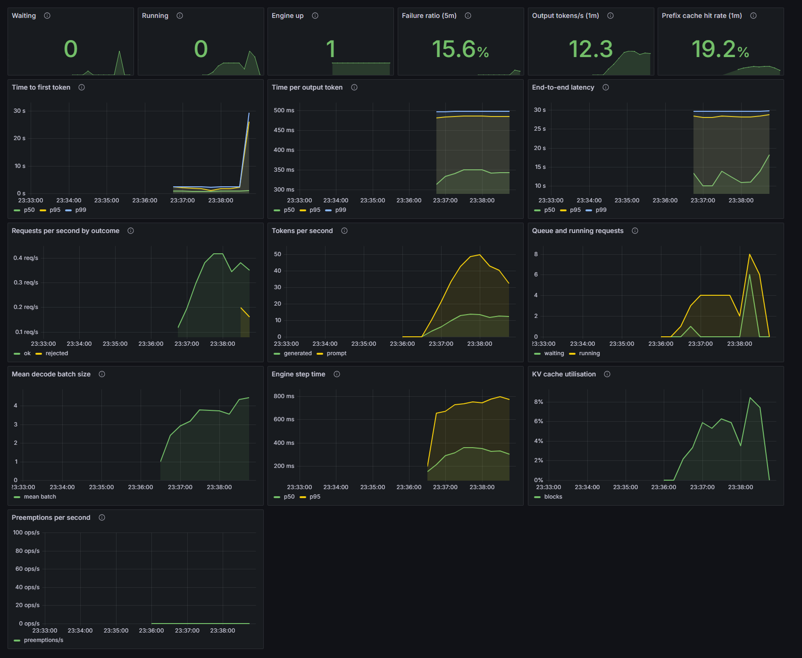

# miniserve

An LLM inference engine written from scratch in PyTorch, with a streaming API server, monitoring, and benchmarks on CPU and GPU.

[](https://github.com/Tanisha2703/llm_infrence_engine/actions/workflows/ci.yml)
  

## Overview

miniserve runs Qwen2.5-0.5B-Instruct using its own implementation of the model (verified against Hugging Face Transformers), without vLLM or `generate`. It implements the techniques used in production serving systems and checks each one against the simpler path it replaces.

| Area | Implemented |
|---|---|
| Decoding | KV cache, exact speculative decoding (draft model and n-gram), CUDA-graph decoding |
| Scheduling | Continuous batching, paged KV cache with prefix caching and preemption |
| Quantization | RTN and GPTQ int4, SmoothQuant int8, int8 KV cache |
| Serving | OpenAI-compatible streaming API (FastAPI), backpressure, cancel on disconnect |
| Operations | Prometheus metrics, Grafana dashboard, alert rules, Docker Compose |
| Evaluation | Open-loop and closed-loop load tester, benchmark scripts, GPU runs on Modal |

## Key results

| Result | Detail |
|---|---|
| 3.8x faster GPU decode step | CUDA graphs: 24.8 ms to 6.5 ms at batch 16 on an A10. Output unchanged. |
| About 4x lower p95 time-to-first-token | Continuous vs static batching over HTTP, reproduced on three GPU runs. |
| 14 vs 8 concurrent requests | Paged KV cache vs fixed slots at equal memory (1.32x throughput on the GPU). |
| Perplexity 25.4 to 20.8 | GPTQ vs round-to-nearest int4 at identical size (fp32 baseline: 18.1); 7.75x smaller layer weights. |
| 159 tests | Each optimization is checked token-for-token against the simple path. |



*The provisioned Grafana dashboard during a real run: steady load, then an overload burst.*

## Quick start

```bash
docker compose up --build        # or: podman compose up --build
```

This starts the server (http://localhost:8000), Prometheus (:9090) and Grafana (http://localhost:3000, login `admin` / `admin`, dashboard "miniserve"). The first start downloads the model (about 1 GB) into a volume, and the API is ready once `/health` returns OK.

```bash
curl localhost:8000/v1/completions -H 'content-type: application/json' \
     -d '{"prompt": "The three primary colors are", "max_tokens": 24, "stream": true}'
```

The fp32 CPU model needs about 4 GB of free memory for the container. `MINISERVE_DTYPE=bfloat16 docker compose up` halves that.

### Without Docker

```bash
python -m venv .venv && source .venv/bin/activate          # Windows: .venv\Scripts\activate
pip install torch --index-url https://download.pytorch.org/whl/cpu
pip install -e ".[dev,eval,serve]"
pytest -q                                                    # -m "not heavy" skips the test that needs about 9 GB of RAM

python -m miniserve.server --engine paged                    # add --cuda-graphs with --device cuda on a GPU
python benchmarks/loadtest.py --spawn "--engine paged" --rate 0.5 --requests 30
```

Shortcuts are in the [Makefile](Makefile). For GPU runs, copy `.env.example` to `.env`, add a Modal token, and run `modal run benchmarks/modal_run.py --suite smoke`. A worst-case cost estimate is checked against `MINISERVE_BUDGET_USD` before anything runs.

## Findings

### 1. Decoding on a GPU is launch-bound

One decode step of the eager engine launches 1,358 kernels and takes 18-25 ms whether the batch is 1 or 32. About 97-98% of that time is the CPU issuing launches; the memory-bandwidth ideal is about 2 ms.

### 2. CUDA graphs remove the overhead

The decode step is recorded once per batch size and replayed with a single launch. On the same A10 in the same container, the step drops from 24.8 ms to 6.5 ms at batch 16 (3.8x), and engine throughput on a request burst rises from 416 to 774 tok/s (1.86x). Output is unchanged: exact in fp32 on the GPU, covered by 8 GPU tests.


Over HTTP the gain is smaller (443 to 598 tok/s, 1.35x, in a same-container comparison). I first suspected the server's Python code, then profiled the live server with a sampling profiler: the event loop is 95% idle, the engine thread spends 66% of its time waiting for the GPU, and 17% is eager prefill. Batching prefills is the next optimization and is not implemented.

### 3. Continuous batching

Served over HTTP with 16 clients on an A10 / A10G (eager decode), continuous batching gives 1.22-1.25x the throughput and 3.8-4.0x lower p95 time-to-first-token than static batching, across three GPU runs. On CPU it gave 2.0-2.1x over sequential serving. The paged KV cache held 14 concurrent requests instead of 8 at equal memory.


### 4. Quantization

GPTQ recovers most of the accuracy lost to 4-bit rounding at identical size (perplexity 25.4 vs 20.8 at group size 128; fp32 baseline 18.1). A diagnostic found why 8-bit activation quantization fails on this model: first-token "massive activations" (values of 1,000-1,600 against a typical 2-12) at the `down_proj` inputs. Per-token scales fix it (perplexity 79.5 to 18.5).


### 5. Negative results

- Quantization gives no speedup without fused kernels; dequantizing on every call is 4-8x slower.
- Speculative decoding with a draft model is slower on the eager GPU engine (0.62-0.85x), because the draft step costs 82% of a target step. A free n-gram drafter wins on copy-heavy text (1.44-1.56x).

Full tables, methodology and caveats: [docs/RESULTS.md](docs/RESULTS.md). Raw data for every number: [results/](results/README.md).

## Testing

- **159 tests** run on a laptop and on a clean Linux container. The equality chain is: Hugging Face model = this model = cached = batched = paged = speculative = CUDA graph = served over HTTP (fp32). Quantization is tested against measured error bounds and perplexity.
- **Bug injection:** I deliberately introduced 18 bugs into the riskiest code (quantization, server, load tester, monitoring config, batched sampling) to confirm the tests fail. This exposed weak tests, which I strengthened.
- **Monitoring is verified:** all 26 dashboard queries were run against real Prometheus and Grafana containers, an alert was triggered, and a test fails if a dashboard query references a metric the server does not export.
- **Run elsewhere than my laptop:** the suite on a clean cloud machine exposed a CPU-dependent assertion and a memory problem (12.3 GB peak), both fixed (5.6 GB). Total cloud spend for all runs was about $1.1 at list prices (ledger in `results/raw/modal_spend.json`).

## Limitations

- No custom CUDA or Triton kernels. Paged attention is a gather, and quantization is simulated in floating point, so no quantization speed claim is made. CUDA graphs cover the slot-cache continuous engine only, not the paged engine, prefill or speculative decoding.
- After graphs, the decode step is still about 3x above the memory-bandwidth ideal, and prefill is still eager. No comparison is made with tuned systems such as vLLM.
- One small model (0.5B), short contexts (up to about 600 tokens), and WikiText-2 perplexity only. GPU numbers come from one GPU family (two variants differing by about 20%) with 64 requests per run, so p99 is effectively the maximum.
- CI (tests, deploy-config validation, Docker build) runs on CPU only; GPU tests and benchmarks ran on Modal. The Docker setup was tested locally with Podman, not Docker, and the GPU image build argument is untested.

## Repository layout

| Path | Contents |
|---|---|
| `src/miniserve/` | model, loader, caches, engines, CUDA-graph decoder, speculative decoding, quantization, server |
| `tests/` | the 159 tests |
| `benchmarks/` | one script per experiment, load tester, GPU runner, figure generator |
| `results/` | raw JSON for every reported number, cost ledger, figures ([index](results/README.md)) |
| `deploy/` | Prometheus config and alert rules, Grafana provisioning and dashboard |
| `docs/` | [RESULTS.md](docs/RESULTS.md), [ARCHITECTURE.md](docs/ARCHITECTURE.md), [papers.md](docs/papers.md) |

## References

Orca (iteration-level scheduling), vLLM / PagedAttention, Leviathan et al. and Chen et al. (speculative sampling), GPTQ, SmoothQuant, LLM.int8(), FlashAttention (via PyTorch SDPA), CUDA Graphs. Details in [docs/papers.md](docs/papers.md).

## License

MIT
