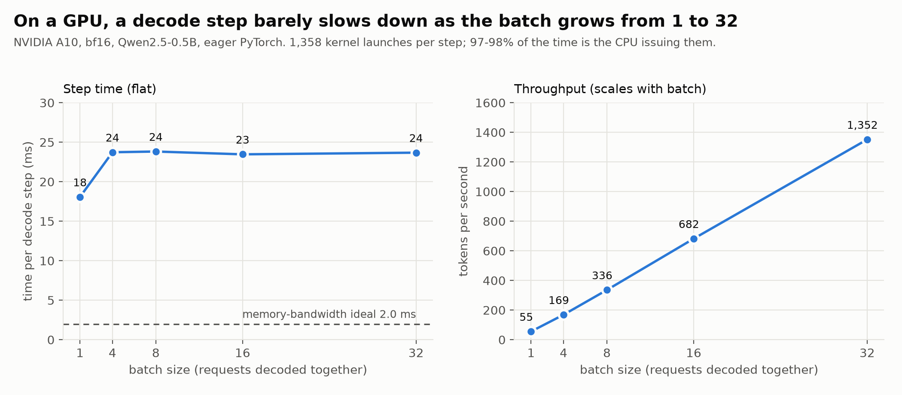
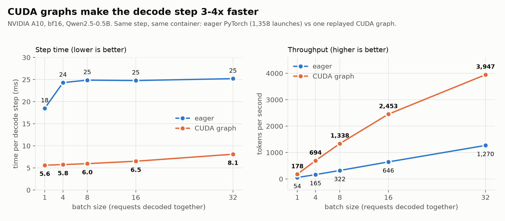
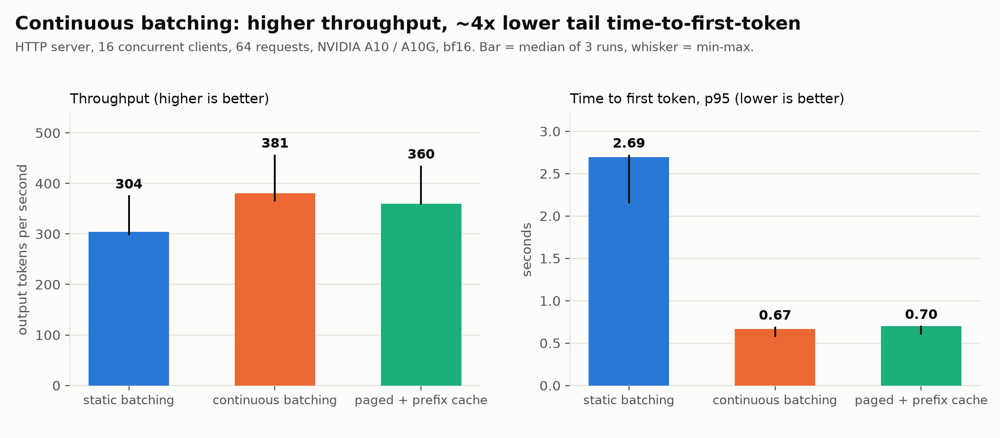
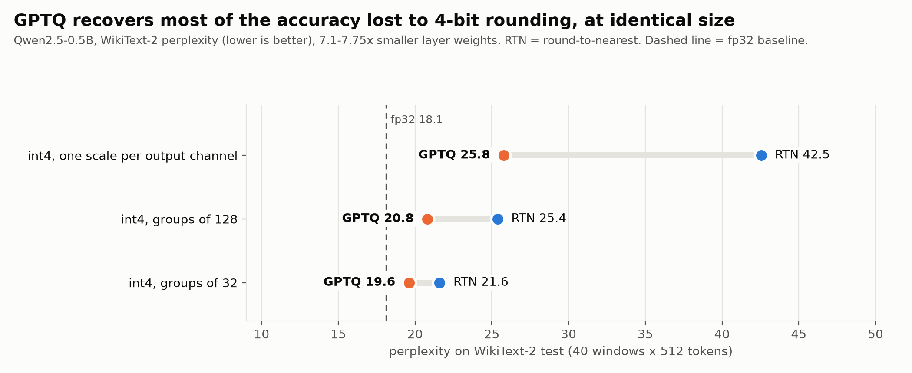

# Results

Every number below was measured with the scripts in `benchmarks/` and is stored as raw JSON in `results/`. Figures are regenerated from those files by `benchmarks/make_figures.py`.

## Setup
| | CPU runs | GPU runs |
|---|---|---|
| Hardware | Ryzen 5 5625U laptop, 6 threads, ~29 GB/s measured memory read bandwidth | One rented NVIDIA A10-class GPU on Modal (24 GB; the same request returned an `A10` once and an `A10G` twice), 4-vCPU container, 503 GB/s measured read bandwidth |
| Precision | fp32 | bf16 (correctness claims are for fp32; see below) |
| Software | torch 2.14.1, transformers 5.20.2 | identical versions (pinned in `benchmarks/modal_run.py`) |
| Model | Qwen2.5-0.5B-Instruct (Qwen2.5-1.5B-Instruct as the speculative-decoding target) | same |

Laptop speed drifts (decode took 109-154 ms/token for identical code), so CPU comparisons quote ranges over repeated runs. GPU serving numbers come from three runs on two GPU variants that differ by ~20%. **p99 with 24-64 requests is roughly the maximum; quote p50/p95.**

## Correctness
* Our model equals Hugging Face's: logits and greedy text (`tests/test_model_parity.py`).
* Cached, batched, paged/prefix-cached/preempted and speculative generation all equal single-sequence generation token for token (fp32, CPU tests).
* **Re-checked on the GPU** (`benchmarks/gpu_parity.py`, 4 prompts x 24 tokens): fp32 is exact for every path (100% of tokens identical). In bf16, batching and paging paths agree on 95.8% of tokens (one of four prompts diverges at token 20), speculative decoding on 100%. The fp32 result shows the scheduling code is right; the bf16 drift is rounding (a batched and a single-row matmul round differently, so a near-tied argmax can flip).

## Decode on a GPU is launch-bound (the central finding)

A decode step of this eager-PyTorch engine launches **1,358 kernels** and takes **18-24 ms for any batch from 1 to 32**; 97-98% of that is the CPU enqueueing the launches (`benchmarks/diag_gpu_launch.py`), against a memory-bandwidth ideal of 1.96 ms (0.99 GB of bf16 weights / 503 GB/s). So the step is ~9-12x slower than the roofline, and **throughput scales almost linearly with batch size** (55 tok/s at batch 1, 1,352 at batch 32). CUDA graphs remove most of this overhead (next section).

This one fact explains four other results:
1. Continuous batching helps a lot (decoding more requests per step is nearly free).
2. The KV cache shows **no** speedup on the GPU at 16-512 tokens (15.2 vs 15.4 ms/token): recomputing a short prompt costs a few milliseconds of GPU work, hidden under ~15 ms of launch overhead. (On the CPU the cache gave 2.5x at 16-token prompts and 8-11x at 256.)
3. A draft model cannot speed up decoding (below).
4. Verifying several speculative tokens is almost free (1.1x one step).

## The fix: CUDA graphs

A CUDA graph records the whole step once and replays it with a single launch. Capture needs fixed shapes, fixed memory addresses and no value read back to the CPU, so the decode path runs through a static-shape cache view (`StaticSlotBatch`: attends over the full `max_len` window with a mask, takes slot ids as a tensor) and `GraphDecoder` captures one graph per batch size; a step with `n` requests uses the smallest captured size `>= n`, with the padding rows parked in a scratch slot that no request owns. Measured in **one Modal container on one A10**, so the GPU variant cancels out (`results/raw/gpu_graphs_*.json`):

| | eager | CUDA graphs | |
|---|---|---|---|
| decode step, batch 1 / 4 / 8 / 16 / 32 | 18.5 / 24.3 / 24.9 / 24.8 / 25.2 ms | 5.6 / 5.8 / 6.0 / 6.5 / 8.1 ms | **3.3 / 4.2 / 4.2 / 3.8 / 3.1x** |
| tokens/s at batch 16 / 32 | 646 / 1,270 | 2,453 / 3,947 | |
| engine, burst of 32 requests: throughput | 416 tok/s | **774 tok/s** | 1.86x |
| engine, burst: TTFT mean / p95 | 0.66 / 1.38 s | 0.44 / 0.88 s | |
| engine, burst: E2E mean / p95 | 1.4 / 2.1 s | 0.8 / 1.2 s | |
| HTTP, 16 clients: throughput | 443 tok/s | 598 tok/s (a later run: 715) | 1.35x |
| HTTP: TPOT p50 · TTFT p95 · E2E p95 | 29.4 ms · 0.575 s · 4.01 s | 23.8 ms · 0.511 s · 3.37 s | |

**Correctness:** 8 tests on the GPU: the graph engine equals the eager engine on a scripted run with mid-flight joins and equals single-sequence generation; every captured batch size including padded ones (1-7 requests) matches eager logits; 30 consecutive replays track the eager path. `gpu_parity.py`: exact in fp32; in bf16 the graph path shows the same rounding drift as the eager engine (95.8% token agreement).

The step is still ~3x above the bandwidth ideal (host-to-device input copies, the `lm_head` over a 152k vocabulary, attention over the full window, GQA `repeat_interleave` copies). Graphs cover the slot-cache continuous engine only.

### Where the time goes after graphs (sampling profile of the live server)
Over HTTP the gain (1.35x) is smaller than the step speedup (3.8x). I had guessed the server's own Python code was responsible, so I profiled the running server under load with a small sampling profiler (`MINISERVE_PROFILE=1`, `src/miniserve/profiling.py`; raw output `results/raw/gpu_profile_threads.txt`):

| thread | where its samples were |
|---|---|
| **event loop (HTTP, SSE, tokenizer)** | **94.8% idle** in `select`; 4.2% writing responses |
| **engine thread** | **66%** waiting for the GPU (the synchronizing `.tolist()` after the decode graph); **17% in prefill, which is still eager and launch-bound**; 5% launching the graph; 3% handing tokens to the event loop |

The hypothesis was wrong: the server is not the bottleneck. The engine spends most of its time on the GPU, and the next largest share is eager prefill, so **batching prefills (one forward pass for several waiting prompts) is the identified next optimization**; it is not implemented.

## Scheduling: static vs continuous batching, paged KV cache
Engine only (no HTTP), 32 requests in a burst, 16 slots, A10:

| | throughput | TTFT mean / p95 | wasted rows |
|---|---|---|---|
| sequential | 52 tok/s | 8.26 s / 15.86 s | 0% |
| static batch=16 | 352 tok/s | 0.82 s / 1.59 s | 42% |
| continuous, 16 slots | 387 tok/s | 0.71 s / 1.48 s | 0% |

CPU (12 requests, burst): continuous = 2.0-2.1x sequential and 1.4-1.45x static throughput; under staggered arrivals mean TTFT was 6-7x lower than static; static wasted 21-36% of computed rows.

**Paged KV cache** at equal memory (20-request burst): slots held 8 concurrent requests with 50% of committed memory useful; paging held **14 with 94% useful**, for **1.32x throughput on the GPU** (1.25-1.27x on the CPU). The paged-attention gather costs 1.03-1.04x per decode step. Prefix caching on a shared 192-token system prompt skipped **82%** of prompt tokens (CPU: mean TTFT 3.7-4.5x lower; on the GPU prefill is already so fast that latency did not change).

## Serving over HTTP

GPU, 16 clients, 64 requests, outputs of 32/64/128 tokens (per-run values):

| | A10 | A10G run 1 | A10G run 2 |
|---|---|---|---|
| continuous: tok/s · TTFT p50 / p95 · TPOT p50 | 457 · 0.048 / 0.572 s · 28 ms | 381 · 0.058 / 0.668 s · 34 ms | 364 · 0.059 / 0.695 s · 36 ms |
| paged + prefix cache: tok/s · TTFT p95 | 435 · 0.597 s | 360 · 0.699 s | 357 · 0.704 s |
| static: tok/s · TTFT p50 / p95 | 376 · 0.379 / 2.152 s | 304 · 0.438 / 2.693 s | 298 · 0.444 / 2.725 s |

Continuous vs static, consistently across the three runs: **1.22-1.25x throughput and 3.8-4.0x lower p95 time-to-first-token**. Paged is within 2-6% of continuous (its benefit is memory, not speed). Served time-per-token (28-36 ms) is 45-85% above the bare eager engine step (19.5 ms at batch 16). I first suspected the server's own Python code; profiling showed the event loop is 95% idle and the extra time is prefill interleaved with decoding (see above).

CPU (8 clients, 24 requests, 2 fresh-server repeats, median [min-max]): static 10.8 tok/s, continuous 13.2 [13.0-13.5], paged 13.0 [12.3-13.7]; TTFT p50 4.0 s vs 1.1 s (3.6x lower) and p95 15.3 s vs 5.6 s (2.7x lower).

**Capacity and load shedding** (CPU, open loop, Poisson arrivals, queue limit 6, continuous batching):

| arrivals/s | ok | 429 | tok/s | TTFT p50 | TTFT p95 |
|---|---|---|---|---|---|
| 0.4 | 24 | 0 | 12.7 | 0.57 s | 1.62 s |
| 0.8 | 22 | 2 | 13.9 | 3.98 s | 14.4 s |
| 1.6 | 16 | 8 | 13.2 | 2.65 s | 14.1 s |

Throughput saturates at ~13 tok/s (about 0.4 requests/s); beyond that the server answers `429` and tail latency is bounded by the queue limit instead of growing without limit.

## Speculative decoding
Exact speculative sampling (output distribution provably unchanged; verified by token-for-token and statistical tests). Target Qwen2.5-1.5B, draft Qwen2.5-0.5B, greedy decoding, 4 prompts x 64 tokens:

| | CPU (fp32) | GPU (A10, bf16) |
|---|---|---|
| draft step cost / target step cost (c) | 0.45 | **0.82** |
| cost of verifying up to 9 tokens vs 1 | not cheap | 1.10-1.14x |
| draft model, k=1 / 2 | 1.30-1.38x (k=1) | 0.85x (k=2); 0.62-0.70x at k=4-6 |
| n-gram (prompt-lookup) drafter, open-ended text | 0.64-0.94x | 1.02x |
| n-gram drafter, copy-heavy text | | **1.44-1.56x** |

The speedup model `E / (k*c + v)` (expected tokens per round over its cost), fed with the *measured* costs and acceptance rate, predicted the draft-model results within ~0.05x on open-ended text and was optimistic by 0.10-0.12 on copy-heavy text. **A speculative speedup is a property of the hardware and software stack, not of the algorithm**: on an eager engine the draft step is nearly as expensive as a target step, so a draft model loses, while a free drafter wins when the text repeats itself.

## Quantization

Qwen2.5-0.5B, fp32 baseline, WikiText-2 test perplexity (40 windows x 512 tokens, baseline **18.10**; absolute values are not comparable with published numbers that use 2048-token windows). Calibration uses a separate train-split sample. Quality of every scheme:

| scheme | perplexity | layer weights (MiB) |
|---|---|---|
| fp32 | 18.10 | 1,365 |
| RTN int8 per-tensor / per-channel | 18.86 / **18.03** | 342 |
| RTN int4 per-channel / g128 / g64 / g32 | 42.5 / 25.4 / 22.8 / 21.6 | 171 / 176 / 181 / 192 |
| RTN int4 g128, asymmetric | 22.2 | 179 |
| RTN int3 g32 | 91.5 | 149 (ideal packed) |
| **GPTQ** int4 per-channel / g128 / g32 | 25.8 / **20.8** / **19.6** | 171 / 176 / 192 |
| GPTQ int3 g32 | 33.4 | 149 (ideal packed) |
| W8A8 per-tensor activation scales / per-token | 79.5 / 18.5 | 342 |
| W8A8 + SmoothQuant (per-tensor) | 75.6 | 342 |
| int8 KV cache, per-token key scales / static per-channel key scales | 18.94 / **18.12** | |

* int8 per-channel is lossless; int4 loses accuracy depending on scale granularity; **GPTQ removes most of the loss at identical size** (g128: 25.4 → 20.8).
* W8A8 with per-tensor activation scales fails (79.5). A diagnostic located the cause: **first-token "massive activations"** (values of 1,000-1,600 against typical 2-12) at the inputs of `down_proj` in layers 2, 3 and 21. Per-token scales isolate them (18.5); SmoothQuant, which targets channel outliers, barely helps (75.6). (My first explanation was channel outliers; the measurement said otherwise.)
* The int8 KV cache loses 0.84 perplexity with per-token scales and only 0.02 with static per-channel key scales (keys have outlier channels).
* Whole-model size shrinks 2.7x, less than the layers' 7.75x, because the 519 MiB tied embedding stays fp32.
* **No speedup is claimed.** There are no fused kernels: dequantizing on every call is 4-8x *slower* than fp32 on the CPU, and PyTorch's own dynamic int8 kernel gives 1.02x decode at unusable perplexity (177). Greedy outputs diverge from fp32 text (even int8 per-channel after ~21 of 32 tokens), which is why perplexity is the metric.

## Test suite
159 tests (155 run on any CPU machine; 4 need a GPU and were run on Modal) pass on the laptop and on a clean Linux container (about 4 minutes). Running the suite on the container exposed two problems of my own making, both fixed:
* an exact-equality assertion that depended on the CPU's matrix-multiply kernels (it failed only on the cloud CPU; now a tolerance plus an argmax check);
* memory that grew from 5 GB to **12.3 GB** during the run because each test module loaded its own copy of the model (this crashed a laptop with little free RAM). A session-scoped model and garbage collection between modules cut the peak to **5.6 GB** and the run from 377 s to 239 s (`results/raw/modal_test_run_before_fix.txt` vs `results/raw/modal_test_run.txt`). The one test that loads the 1.5B model is marked `heavy` (`pytest -m "not heavy"` skips it).

## Limits
One small model (0.5B; 1.5B only as a speculative target); short contexts (≤ ~600 tokens); WikiText-2 perplexity only, no downstream tasks; bf16-only GPU runs on one GPU family (two variants, three samples, 64 requests each); CUDA graphs only for the slot-cache continuous engine (prefill, the paged engine and speculative decoding stay eager), so absolute throughput describes this engine and not tuned systems; no custom kernels (paged attention is a gather, quantization is simulated); load generator and server share a machine in every run.
